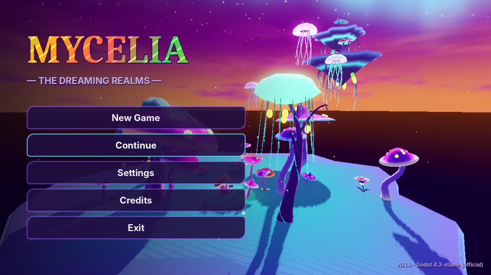
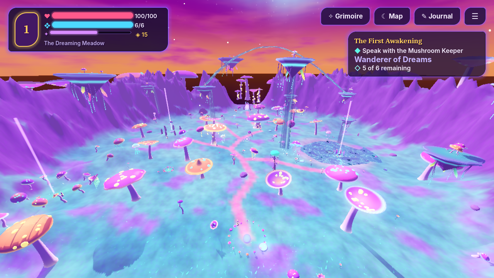
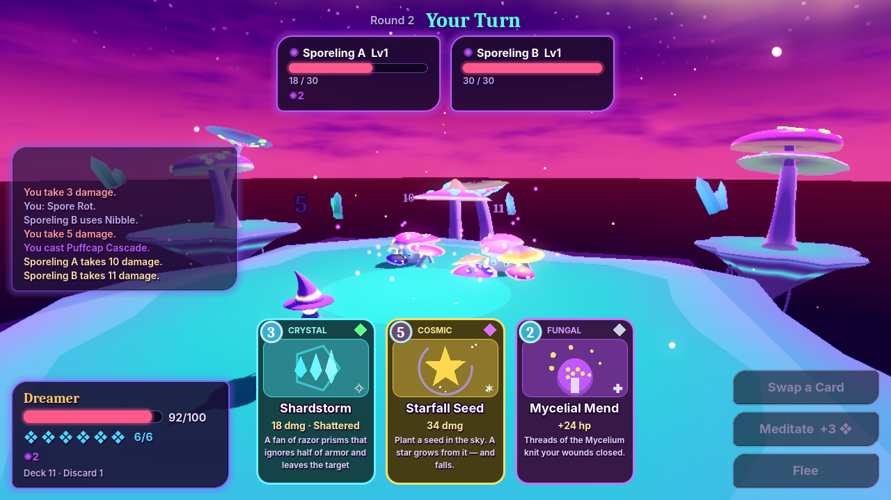
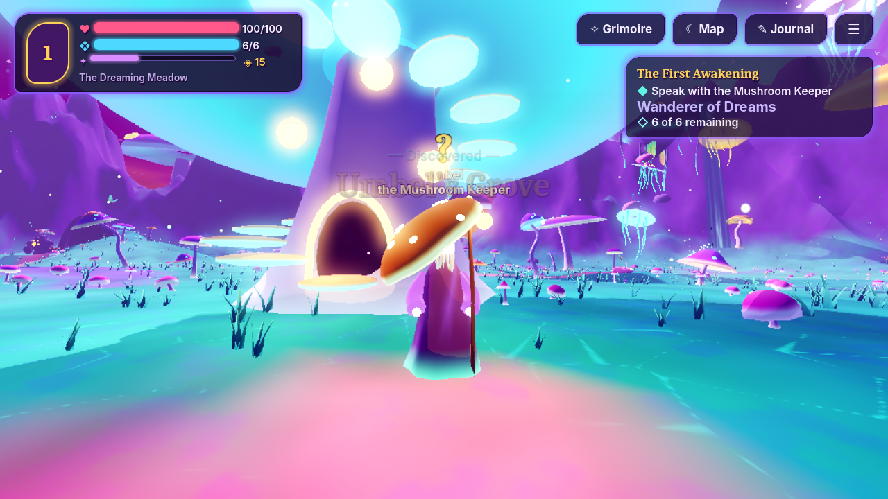
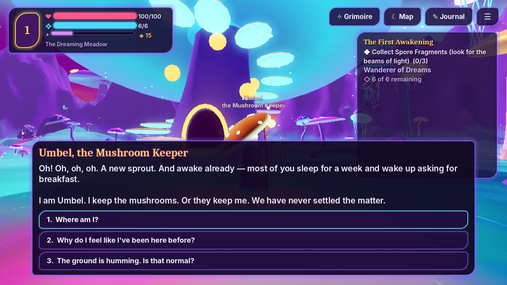

# MYCELIA — The Dreaming Realms

A dark, surreal fantasy action-adventure for Android, iOS and PC. You choose
one of four callings — **Assassin, Spirit, Wizard or Grimlet** — explore a
dreaming meadow in first person, and fight in real time from an
over-the-shoulder camera. Built with **Godot 4.3** in typed GDScript.

## New in v0.3 — the Deep Fantasy revolution

- **Four callings** chosen at the Fourfold Threshold, each with its own
  lore, avatar, five signature items and five real abilities.
- **Real-time combat**: light combos, charged heavy attacks, dodge with
  invulnerability, shield block and perfect parry, bow with draw and four
  arrow types, weapon switching, lock-on, stamina. Enemies telegraph every
  attack, have weak spots, fight in packs, and the Spore Golem has phases.
- **Learning Paths**: five per calling (80 steps), bought with Mana Essence
  earned from quests, chests, bosses, discoveries and levels.
- **Factions**: four settlements (Duskhollow, Gnarlhollow, Lanternhome,
  Spireholm) with mentors, merchants, patrolling guards and villagers that
  react to your reputation; disguises and goodwill tasks keep every village
  reachable.
- **Treasure**: chests across the meadow, Class Seals only a certain calling
  can open (or a Wanderkey), faction vaults.
- **Fixed**: long quest texts no longer block jump/sprint on touch screens.

The turn-based card duel from v0.1 is still in the code (`legacy_card_duel`)
but no longer used by the world.



| The Dreaming Meadow | Spell-card combat |
|---|---|
|  |  |
|  |  |

## What is playable today (v0.1 vertical slice)

- Main menu with New Game, Continue, Settings, Credits and Exit (Exit is PC only).
- **The Dreaming Meadow**, a procedurally built valley that is identical on every run because it uses a fixed seed. It contains:
  - giant walkable mushrooms and spiral trees
  - glowing crystals and talking flowers
  - floating islands, a sky river and the glowing lake Glimmermere
  - the Rootstone Circle, Umbel's mushroom house, a hidden hollow and a bounce-mushroom route up to Drift Isle
  - sealed gates to future regions
- A first-person controller (walk, run, sprint, jump, head bob) for keyboard and mouse, gamepad, and multi-touch with a virtual joystick and a separate look area.
- An interaction system covering collectibles, lore stones, mechanisms, portals, rest pools and NPCs.
- Three NPCs with branching dialogue: **Umbel the Mushroom Keeper**, **Madame Petalune** and **Ollo**, a snail merchant with a working shop.
- Quests:
  - main story: *The First Awakening* → *The Hum Beneath* → *The Sealed Gate*
  - side quests: one collection, one combat and one discovery quest
- **Tactical card combat** in a dedicated floating arena:
  - 14 working spells across five disciplines: Fungal, Crystal, Nature, Cosmic and Chaos
  - 6 creature types, including a two-phase boss with telegraphed charge attacks
  - element advantages, status effects and enemy AI with distinct personalities
- RPG systems:
  - XP and levels
  - a Fungal skill tree with 4 branches and 12 nodes
  - inventory and six equipment slots
  - deck building in the Grimoire
  - a journal (quests, lore, bestiary) and a map painted from the terrain itself
- Saving and loading: four slots (one autosave, three manual), a versioned format with migration and a backup file, and autosave at safe points.
- Graphics presets (Low/Medium/High), render scale, an FPS overlay (F3) and a CSV performance log.
- All models, materials, shaders, music and sound effects are generated by the project's own code.

## Running

1. Install **Godot 4.3** (standard build, not .NET).
2. Open `project.godot` in Godot and press **Play**.
   - The first time you open the project, Godot imports the fonts and audio and builds its class cache.

### Command-line tools

The test suite needs no display:

```bash
godot --headless --fixed-fps 60 res://tests/test_runner.tscn
```

Compile-check every script:

```bash
godot --headless res://tools/dev/check_scripts.tscn
```

Regenerate the data resources after editing `tools/build_content.gd`:

```bash
godot --headless --script res://tools/build_content.gd
```

Regenerate all audio (needs Python 3 and numpy):

```bash
python3 tools/generate_audio.py
```

Screenshot tour of the meadow (needs a display):

```bash
godot --rendering-driver opengl3 res://tools/dev/capture_tour.tscn -- /tmp/shots
```

## Controls

| Action | PC | Touch |
|---|---|---|
| Move | WASD / arrow keys | Left side: floating joystick |
| Look | Mouse | Right side: drag |
| Jump / sprint / walk | Space / Shift / Ctrl | ⤒ button / » toggle |
| Interact | E | ✋ button (shown when something is in range) |
| Grimoire | I / Tab (B spellbook, K skills, J journal, M map, C character) | Buttons at the top right |
| Pause | Esc | ☰ |
| Combat | Click cards (or keys 1–4), then click a target | Tap card, then tap target |

## Project layout

See [docs/ARCHITECTURE.md](docs/ARCHITECTURE.md). In short:

| Folder | Contents |
|---|---|
| `scripts/core` | Autoloads and the session model |
| `scripts/world` | Generators, terrain and regions |
| `scripts/combat` | Combat rules, AI, arena and finite state machine |
| `scripts/ui` | All interfaces |
| `resources/` | Data (`.tres` built by `tools/build_content.gd`, plus JSON dialogue, skills and shops) |
| `tests/` | The test harness |

## Documentation

- [Development status](docs/DEVELOPMENT_STATUS.md)
- [Architecture](docs/ARCHITECTURE.md)
- [Game design](docs/GAME_DESIGN_DOCUMENT.md)
- [Known issues](docs/KNOWN_ISSUES.md)
- [Roadmap](docs/ROADMAP.md)
- [Asset pipeline](docs/ASSET_PIPELINE.md)
- [Contributing](CONTRIBUTING.md)
- [Changelog](CHANGELOG.md)

## Licenses

Code and generated assets: original to this project. Fonts: Inter and Caladea,
both under the SIL Open Font License 1.1 (see `assets/fonts/LICENSE-*.txt`).
Engine: Godot (MIT).
